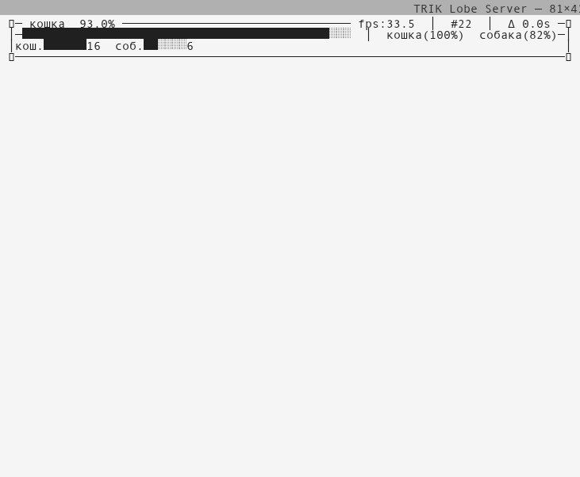
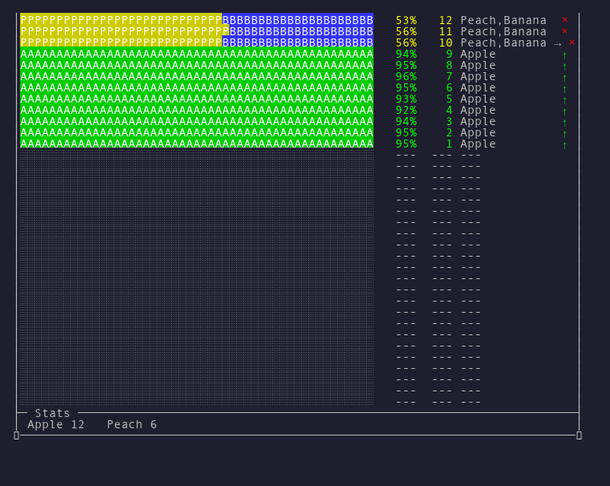

# TRIK Lobe Server

[](https://github.com/trikset/trik-lobe-server/actions/workflows/python-app.yml)


Сервер для выполнения инференса ML-моделей (ONNX / TFLite) на ПК и отправки результатов
на робота TRIK или в TRIK Studio по TCP.

## Установка

1. Скачайте архив для вашей платформы с последней версией сервера
   [здесь](https://github.com/trikset/trik-lobe-server/releases/latest).
1. Распакуйте архив.
1. Отредактируйте `settings.ini` (см. ниже).

## Релизы

Релизы помечаются тегами вида `vYY.MM.DD` (например, `v26.08.03`). К каждому
релизу прикреплён один архив для каждой платформы — внутри лежит исполняемый
файл и `settings.ini`. Релиз сначала создаётся как черновик, а публикуется
после проверки сопровождающим.

Имена файлов содержат версию релиза, например
`TRIKLobeServer-v26.08.03-Windows.zip`,
`TRIKLobeServer-v26.08.03-Linux.tar.gz` или
`TRIKLobeServer-v26.08.03-macOS.tar.gz`. Windows использует `.zip`,
Linux и macOS — `.tar.gz`. Внутри каждого архива лежит исполняемый файл с
версией в имени (`TRIKLobeServer-v26.08.03.exe` для Windows,
`TRIKLobeServer-v26.08.03.bin` для Linux/macOS).

## Системные требования

Документированный базовый уровень совместимости с ОС (продуктовое решение,
см. `MEMORY.md`). Изменение базового уровня — это изменение продукта: оно
требует обновления этого раздела и проверки сборок.

| ОС | Архитектура | Минимальная версия |
|---|---|---|
| Linux | x86_64 | glibc ≥ 2.28 (Ubuntu 20.04+, Debian 11+, RHEL 8+, Fedora 31+) |
| macOS | arm64 (Apple Silicon) | macOS 14 (Sonoma) |
| Windows | x86_64 | Windows 10 22H2+ |

Практическое следствие: Intel-версия macOS не поддерживается — для обеих
ML-библиотек (onnxruntime, LiteRT) больше не существует пакетов под x86_64;
минимальную версию macOS 14 диктует пакет onnxruntime.

## Настройка (`settings.ini`)

| Параметр | Описание |
|---|---|
| `SERVER_IP` | IP робота или студии. Для студии обычно `127.0.0.1` |
| `MY_HULL_NUMBER` | Борт-номер этого сервера. Выберите незанятый. |
| `SERVER_PORT` | Порт TCP-сервера на роботе/студии. Обычно `8889` |
| `MODEL_PATH` | Путь к папке с моделью. Оставьте пустым, если папка рядом с .exe |
| `PHOTO_URL` | URL snapshot беспроводной камеры (например, `http://192.168.1.100:8080/?action=snapshot`). Оставьте пустым для других режимов |
| `GET_IMAGES_FROM_ROBOT` | `True` — получать кадр с камеры робота. `PHOTO_URL` должно быть пустым |
| `CAMERA_NUMBER` | Номер веб-камеры ПК (0, 1, 2…). Используется только если `PHOTO_URL` пуст и `GET_IMAGES_FROM_ROBOT=False` |
| `USERNAME` / `PASSWORD` | Аутентификация для `PHOTO_URL` (если требуется) |
| `OUTPUT_MODE` | Режим вывода: `user` (цветной, в stderr) или `stdout` (табуляция, в stdout). Раздел `[UI]` |
| `COLOR_ENABLED` | Цветной вывод: `true` / `false`. Только в режиме `user`. Раздел `[UI]` |

## Живой вывод на экране

В режиме `user` (по умолчанию) сервер показывает полноэкранную приборную
панель, которая обновляется каждые 0.2 с и заполняет весь терминал:

<p align="center">
  
  <br/>
  
</p>

*Светлая тема (выше) — без ANSI-цветов, для терминалов без поддержки цвета.
Тёмная тема (ниже) — с ANSI-цветами, цветные полосы уверенности.*

Демонстрацию можно запустить вживую: `uv run scripts/fruits-demo.py`.

```
╭─ Current ────────────────────────────────────────────────────────────╮
│ Cherry                                           fps:28  #38  Δ 0.5s │  ← метка + метрики
│  Cherry(95%)  Dewberry(77%)  Apple(59%)                              │  ← легенда кандидатов (цвет: зел/син/пурпур/сер)
├─ History ────────────────────────────────────────────────────────────┤
│Bar                                             %    # Label      Evt │
│██████████████████████████████████████░░░░░░   87%   38   Cherry     →│  ← новая детекция вверху
│███████████████████████████████████████░░░░░   88%   37   Cherry      │  ← каждая строка: бар уверенности, %, номер, метка, событие
│████████████████████████████████████████░░░░   90%   36   Cherry      │
│████████████████████████████████████████░░░░   89%   35   Cherry      │
│█████████████████████████████████████░░░░░░░   84%   34   Cherry      │  ← цвета: зел ≥80%, жёл ≥50%, красн <50%
│████████████████████████████████████░░░░░░░░   83%   33   Cherry     →│  ← → смена метки
│░░░░░░░░░░░░░░░░░░░░░░░░░░░░░░░░░░░░░░░░░░░░   ---  ---   ---         │  ← пустые строки (заполняют экран)
│░░░░░░░░░░░░░░░░░░░░░░░░░░░░░░░░░░░░░░░░░░░░   ---  ---   ---         │
├─ Stats ──────────────────────────────────────────────────────────────┤
│ Apple ████████████████ 210   Banana ████████████████ 210             │  ← статистика по меткам (алфавитно)
╰──────────────────────────────────────────────────────────────────────╯
```

### Элементы панели

| Элемент | Что показывает | Цвета |
|---------|---------------|-------|
| **Строка метки** | Текущий распознанный объект, FPS, номер детекции, время с последней смены метки (Δ) | ★ при свежей детекции (\< 1 с) |
| **Легенда кандидатов** | Все возможные метки с процентом уверенности | 1‑я зелёная, 2‑я синяя, 3‑я пурпурная, остальные серые |
| **История** | Последние N детекций (заполняет оставшееся место терминала) | Бар: зелёный ≥80%, жёлтый ≥50%, красный \<50%. → = смена метки |
| **Статистика** | Суммарное количество по каждой метке (алфавитно) | Бар: зелёный ≥50% от макс, жёлтый ≥20%, красный \<20% |

Строки с `---` заполняют пустое место, чтобы статистика всегда была внизу.

### Режимы

- **Нормальный** — модель уверена: одна метка с высоким процентом, остальные
  значительно ниже. Легенда показывает распределение уверенности.
- **Низкая уверенность** — модель не уверена: все проценты низкие и близкие
  друг к другу. Легенда показывает «размазанную» уверенность.
- **Ошибка** — камера не дала кадра. Метка заменяется на `---`.

### Бейдж соединения

Жёлтый текст на строке метки появляется при вызове `set_status("reconnecting")`:

```
│ ★ Banana  connecting  fps:27  #42  Δ 0.3s                           │
```

В режиме `stdout` (`-o stdout`) выводятся табулированные строки для передачи
в другие программы (grep, awk, логирование).

Лог-файл по умолчанию — `lobe_server.log` рядом с программой. Путь можно
изменить через `--log-file`.

## Подготовка модели

В папку модели положите `model.onnx` или `model.tflite` (или любой другой `.tflite`/`.onnx` файл).

Labels загружаются в следующем приоритете:

1. **`labels.txt`** — одна строка на класс. **Приоритет выше, чем signature.json**
1. **`signature.json` → `classes.Label`** — если `labels.txt` нет

### labels.txt (рекомендуется)

```
кошка
собака
птица
```

### `signature.json` (если нужно явное имя файла или нет labels.txt)

| Поле | Обязательно | Описание |
|------|-------------|----------|
| `classes.Label` | да (если нет labels.txt) | Список имён классов |
| `filename` | нет | Имя файла модели (если в папке несколько) |

```json
{
    "classes": {"Label": ["кошка", "собака"]},
    "filename": "model.onnx"
}
```

**Microsoft Lobe (легаси)** — полный `signature.json` тоже работает, читается только `classes.Label` и `filename`.

## Использование

### С беспроводной камерой

```
PHOTO_URL=http://192.168.1.100:8080/?action=snapshot
GET_IMAGES_FROM_ROBOT=False
```

### С камерой TRIK

```
PHOTO_URL=
GET_IMAGES_FROM_ROBOT=True
```

Включите камеру на роботе перед запуском.

### С камерой ПК

```
PHOTO_URL=
GET_IMAGES_FROM_ROBOT=False
CAMERA_NUMBER=0
```

## Чтение данных в TRIK

Запустите скрипт на TRIK с помощью TRIK Studio:

```python
def main():
    while True:
        predict = mailbox.receive(True)
        print(predict)
        script.wait(1000)
```

## Параметры командной строки

| Параметр | Описание |
|---|---|
| `-o, --output-mode <user|stdout>` | Режим вывода. `user` — цветной вывод в stderr (по умолчанию). `stdout` — табулированный вывод для pipe |
| `--no-color` | Отключить ANSI-цвета (только в режиме `user`) |
| `-v, --verbose` | Подробный вывод в stdout-режиме. Можно указать дважды: `-v -v` |
| `--log-file PATH` | Путь к лог-файлу (по умолчанию `lobe_server.log`) |
| `--version` | Показать версию программы и выйти |

## Поддерживаемые модели

Сервер работает с любой моделью классификации изображений:

- **ONNX** (`*.onnx`) — прямой запуск через onnxruntime.
- **TFLite** (`*.tflite`) — прямой запуск через ai_edge_litert (LiteRT).

Формат авто-определяется по расширению файла. Labels — из `labels.txt` или `signature.json` → `classes.Label` (приоритет у `labels.txt`).

## Для разработчиков

Сборка из исходников:

```bash
uv sync
uv run pyinstaller TRIKLobeServer.py --onefile  # add --icon=trik-studio.ico on Windows
```

Готовый исполняемый файл появится в `dist/`.

Дизайн-решения и устройство соединения описаны в `MEMORY.md`, стратегия
тестирования (100% покрытие, моки) — в `TESTING.md`.
